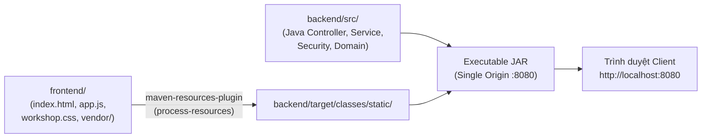

# 🚗 XYZ Auto Service — Workshop Operating System (WorkshopOS)

<div align="center">

[](https://openjdk.org/projects/jdk/21/)
[](https://spring.io/projects/spring-boot)
[](https://www.postgresql.org/)
[](docs/architecture.md)
[-success?style=for-the-badge&logo=junit5&logoColor=white)](docs/test-report.md)
[](https://maven.apache.org/)

**Hệ thống Quản lý Đặt lịch Dịch vụ Ô tô Trực tuyến, Điều phối Công suất Khoang Kỹ thuật và Theo dõi Tiến độ Sửa chữa Thời gian thực.**  
*Đồ án học phần môn học: **Quản lý Dự án Phần mềm (Mã lớp học phần: 71ITSE41503)***

</div>

---

## 📑 MỤC LỤC
1. [Tổng quan dự án & Bối cảnh nghiệp vụ](#1-tổng-quan-dự-án--bối-cảnh-nghiệp-vụ)
2. [Các chức năng cốt lõi (Phạm vi F01 – F09)](#2-các-chức-năng-cốt-lõi-phạm-vi-f01--f09)
3. [Điểm sáng kỹ thuật & Quyết định kiến trúc (ADRs)](#3-điểm-sáng-kỹ-thuật--quyết-định-kiến-trúc-adrs)
4. [Kiến trúc phân tách Frontend / Backend & Cơ chế đóng gói](#4-kiến-trúc-phân-tách-frontend--backend--cơ-chế-đóng-gói)
5. [Hướng dẫn khởi chạy nhanh (1-Click Run)](#5-hướng-dẫn-khởi-chạy-nhanh-1-click-run)
6. [Hướng dẫn triển khai với PostgreSQL thật](#6-hướng-dẫn-triển-khai-với-postgresql-thật)
7. [Danh bạ tài khoản mẫu dùng thử hệ thống](#7-danh-bạ-tài-khoản-mẫu-dùng-thử-hệ-thống)
8. [Kịch bản 6 bước trình diễn luồng nghiệp vụ chuẩn](#8-kịch-bản-6-bước-trình-diễn-luồng-nghiệp-vụ-chuẩn)
9. [Minh chứng kiểm thử tích hợp tự động](#9-minh-chứng-kiểm-thử-tích-hợp-tự-động)
10. [Cấu trúc mã nguồn chuẩn hóa](#10-cấu-trúc-mã-nguồn-chuẩn-hóa)
11. [Hệ thống tài liệu dự án (@docs)](#11-hệ-thống-tài-liệu-dự-án-docs)
12. [Đội ngũ phát triển & Đóng góp thành viên (Contributors)](#12-đội-ngũ-phát-triển--đóng-góp-thành-viên-contributors)

---

## 1. TỔNG QUAN DỰ ÁN & BỐI CẢNH NGHIỆP VỤ

### 1.1. Bối cảnh (Problem Statement)
Trung tâm dịch vụ ô tô XYZ trước đây vận hành tiếp nhận xe bằng điện thoại, bảng tính Excel và sổ tay phân tán:
* Khách hàng không nắm được thời điểm xưởng còn chỗ trống.
* Tình trạng dồn ứ nhiều xe vào cùng một khung giờ vượt quá năng lực phục vụ của cầu nâng và kỹ thuật viên (Overbooking).
* Khách hàng khó nắm bắt tiến độ xử lý của xe sau khi bàn giao vào xưởng.
* Ban giám đốc thiếu dữ liệu định lượng về công suất khai thác trạm và doanh thu ước tính.

### 1.2. Mục tiêu giải pháp (Solution Vision)
WorkshopOS được xây dựng nhằm khép kín toàn bộ chu trình dịch vụ từ lúc khách hàng tra cứu, đặt lịch trực tuyến, nhân viên tiếp nhận phân khoang, đến khi bàn giao xe hoàn tất với tiêu chí: **Trực quan - Chống nghẽn - Bảo mật - Chạy 1-click không phụ thuộc cấu hình phức tạp**.

---

## 2. CÁC CHỨC NĂNG CỐT LÕI (PHẠM VI F01 – F09)

| Mã | Chức năng | Phân hệ | Mô tả thực thi |
| :---: | :--- | :---: | :--- |
| **F01** | **Quản lý dịch vụ** | Manager | Quản lý danh mục 8 gói bảo dưỡng/sửa chữa chuẩn: thời lượng, bảng giá, checklist và bật/tắt kích hoạt. |
| **F02** | **Tra cứu dịch vụ** | Public/Client | Bộ lọc danh mục theo nhóm kỹ thuật (Bảo dưỡng, Phanh, Thay dầu, Động cơ...), tìm kiếm nhanh và xem chi tiết. |
| **F03** | **Đặt lịch trực tuyến** | Customer | Đặt lịch theo Biển số xe, Model, Ngày (Thứ 2 – Thứ 7), 8 khung giờ (08:00–16:00) và chọn gói dịch vụ. Chặn đặt hộ sai SĐT. |
| **F04** | **Quản lý lịch hẹn** | Staff/Manager | Lễ tân xem danh sách toàn xưởng, duyệt lịch (`CONFIRMED`) gán Khoang 1–4 và KTV, hoặc từ chối (`REJECTED`). Đặt trực tiếp vãng lai (`walkIn`). |
| **F05** | **Thay đổi & Hủy lịch** | Customer | Khách đổi ngày/giờ/dịch vụ (chuyển về `PENDING` để duyệt lại) hoặc hủy lịch an toàn khi chưa sửa xe. |
| **F06** | **Theo dõi trạng thái** | Customer | Khách theo dõi vòng đời: `PENDING` ➔ `CONFIRMED` ➔ `IN_PROGRESS` ➔ `COMPLETED`. |
| **F07** | **Quản lý năng lực xưởng** | System/Manager | Kiểm soát giới hạn 3 xe/slot (chỉnh được 1–5); Khóa bi quan chống tranh chấp; Chặn trùng biển số. |
| **F08** | **Báo cáo thống kê** | Manager | Dashboard quản trị đo lường: Tổng số lịch, tỷ lệ tiếp nhận/hủy, lượt đặt và doanh thu dự kiến theo từng dịch vụ. |
| **F09** | **Quản lý tài khoản** | All Roles | Đăng nhập/Đăng ký qua SĐT, băm mật khẩu BCrypt, Session Cookie bảo mật, phân quyền nghiêm ngặt 3 vai trò. |

---

## 3. ĐIỂM SÁNG KỸ THUẬT & QUYẾT ĐỊNH KIẾN TRÚC (ADRs)

1. **Khóa Bi Quan (Pessimistic Locking `SELECT ... FOR UPDATE`)**:
   * Tại [`WorkshopService.java`](backend/src/main/java/com/example/demo/WorkshopService.java#L125), mọi giao dịch đặt chỗ đều khóa dòng cấu hình trạm `workshop_settings` (`id = 1`).
   * Triệt tiêu 100% rủi ro điều kiện tranh đua (Race Condition) khi nhiều khách cùng bấm nút đặt lịch trong cùng một mili-giây.
2. **Kiểm Soát Danh Tính & Chống Giả Mạo Đặt Lịch (Identity Integrity)**:
   * Khách hàng đặt lịch trực tuyến bắt buộc phải đặt đúng SĐT tài khoản đã xác thực của chính mình.
   * Nhân viên (`STAFF`) và Quản lý (`MANAGER`) không được đặt trực tuyến thay khách mà phải sử dụng luồng tiếp nhận tại quầy (`walkIn = true`).
3. **Bảo Toàn Giá Lịch Sử (Price Snapshotting)**:
   * Giá và thời lượng dịch vụ được lưu bản chụp cứng (`@Embeddable ServiceSnapshot`) vào bảng `workshop_appointment_services`.
   * Việc Quản lý thay đổi giá dịch vụ sau này không bao giờ làm sai lệch số tiền của các lịch hẹn đã chốt trong quá khứ.
4. **Cơ Chế Đa Profile (Dual Profile Resilience)**:
   * **Profile `dev` (Default)**: CSDL In-Memory tương thích chuẩn ngữ pháp PostgreSQL (`MODE=PostgreSQL`). Bấm Run là chạy ngay trong 2 giây, không cần cài đặt CSDL ngoại vi.
   * **Profile `postgres`**: Kết nối trực tiếp vào PostgreSQL thật (Cổng `5432` Docker hoặc CSDL doanh nghiệp).
5. **Cấu Trúc Tách Biệt Frontend / Backend Với Quy Trình Build Tự Động**:
   * Phân tách mã nguồn giao diện sang thư mục độc lập `frontend/` (HTML5, Tailwind CSS, JS State Machine, FontAwesome) giúp đội UI làm việc tập trung.
   * `backend/pom.xml` tích hợp `maven-resources-plugin` tự động đồng bộ tài nguyên tĩnh vào classpath khi build, giúp ứng dụng duy trì mô hình phân phối Single-Origin mà không phát sinh phức tạp về CORS hay quản lý 2 máy chủ riêng biệt.

---

## 4. KIẾN TRÚC PHÂN TÁCH FRONTEND / BACKEND & CƠ CHẾ ĐÓNG GÓI

Dự án tổ chức mã nguồn thành 2 thư mục rõ ràng:
- `frontend/`: Toàn bộ mã nguồn giao diện tĩnh của khách hàng và nhân viên.
- `backend/`: Ứng dụng Spring Boot, JPA, Security và REST API.



### Nguyên lý vận hành:
* **Không cần chạy server frontend riêng**: Không cần Node.js, `npm start`, hay reverse proxy. Spring Boot phân phối toàn bộ giao diện tĩnh từ cùng origin với API (`/api/**`).
* **Không gặp lỗi CORS & Session**: Session Cookie (`JSESSIONID`) và CSRF Token (`X-CSRF-TOKEN`) được trình duyệt quản lý tự nhiên và bảo mật cao (`HttpOnly`, `SameSite=Lax`).
* **Hot-Sync khi phát triển**: Khi sửa file trong `frontend/`, chỉ cần chạy lệnh Maven hoặc khởi động lại backend để `maven-resources-plugin` sao chép bản mới vào `target/classes/static/`.

---

## 5. HƯỚNG DẪN KHỞI CHẠY NHANH (1-CLICK RUN)

Yêu cầu môi trường: **Java 21 (JDK 21 LTS)**.

### Cách 1: Chạy nhanh bằng kịch bản dòng lệnh (Khuyên dùng)

Vào thư mục `backend`:
```bat
cd backend
```

* **Chế độ Demo nhanh (In-Memory H2, không cần cài PostgreSQL)**:
  - Trên Windows:
    ```bat
    run-dev.cmd
    ```
  - Trên Linux / macOS:
    ```bash
    sh run-dev.sh
    ```
* **Chế độ PostgreSQL (Docker Compose)**:
  - Khởi động cơ sở dữ liệu:
    ```bat
    docker compose up -d
    ```
  - Khởi chạy backend kết nối PostgreSQL:
    - Trên Windows:
      ```bat
      run-postgres.cmd
      ```
    - Trên Linux / macOS:
      ```bash
      sh run-postgres.sh
      ```

👉 Mở trình duyệt truy cập: **`http://localhost:8080`**

### Cách 2: Khởi chạy trên IntelliJ IDEA hoặc VS Code
1. Mở **IntelliJ IDEA** ➔ Chọn **Open** ➔ Duyệt đến thư mục **`backend`**.
2. Kiểm tra Project SDK: Vào **File ➔ Project Structure ➔ Project ➔ SDK** chọn **JDK 21** (ví dụ `ms-21.0.11`).
3. Mở file `backend/src/main/java/com/example/demo/DemoApplication.java` và bấm **Run ▶** (hoặc `Shift + F10`).
4. Ứng dụng tự động khởi chạy hoàn tất sau 2–3 giây tại: **`http://localhost:8080`**.

---

## 6. HƯỚNG DẪN TRIỂN KHAI VỚI POSTGRESQL THẬT

### Triển khai tự động bằng Docker Compose (Cổng chuẩn 5432)
```bash
# Trong thư mục backend (hoặc thư mục gốc dự án)
docker compose up -d

# Kiểm tra trạng thái container xyz_postgres
docker compose ps
```
Container tự động nạp cấu trúc bảng và dữ liệu mẫu từ `xyz_auto_service_postgresql.sql`.

### Cấu hình biến môi trường kết nối:
Nếu chạy ứng dụng ngoài Docker hoặc trên máy chủ khác:
```bash
# Windows PowerShell
$env:SPRING_PROFILES_ACTIVE = "postgres"
$env:DB_URL = "jdbc:postgresql://localhost:5432/xyz_auto_service"
$env:DB_USER = "postgres"
$env:DB_PASSWORD = "postgres"
.\mvnw.cmd spring-boot:run

# Linux / macOS Bash
export SPRING_PROFILES_ACTIVE=postgres
export DB_URL=jdbc:postgresql://localhost:5432/xyz_auto_service
export DB_USER=postgres
export DB_PASSWORD=postgres
./mvnw spring-boot:run
```

---

## 7. DANH BẠ TÀI KHOẢN MẪU DÙNG THỬ HỆ THỐNG

Hệ thống cung cấp sẵn 3 tài khoản mặc định đại diện cho 3 phân quyền nghiệp vụ (mật khẩu chung: **`12345678`**):

| Vai trò người dùng | Số điện thoại đăng nhập | Mật khẩu | Phạm vi quyền hạn kiểm thử |
| :--- | :---: | :---: | :--- |
| **Quản lý Xưởng (`MANAGER`)** | **`0901234567`** | `12345678` | Quản lý danh mục dịch vụ (F01), điều chỉnh năng lực xưởng (F07), phân quyền tài khoản, xem thống kê & doanh thu (F08). |
| **Lễ tân Tiếp nhận (`STAFF`)** | **`0912345678`** | `12345678` | Quản lý lịch hẹn toàn xưởng (F04), duyệt xe (`CONFIRMED`), gán Khoang 1–4, gán KTV phụ trách, tiếp nhận xe vãng lai (`walkIn`). |
| **Khách hàng Mẫu (`CUSTOMER`)** | **`0988888888`** | `12345678` | Khách VIP, đặt lịch trực tuyến (F03), theo dõi tiến độ sửa chữa xe (F06), đổi hoặc hủy lịch hẹn (F05). |

*(Người dùng mới có thể tự tạo tài khoản Khách hàng trực tiếp trên form Đăng ký của giao diện web).*

---

## 8. KỊCH BẢN 6 BƯỚC TRÌNH DIỄN LUỒNG NGHIỆP VỤ CHUẨN

```text
Khách xem dịch vụ ➔ Đăng nhập ➔ Đặt lịch trực tuyến ➔ Kiểm tra năng lực trạm ➔ Nhân viên duyệt & gán khoang ➔ Cập nhật tiến độ
```

1. **Bước 1 (Xem dịch vụ)**: Truy cập `http://localhost:8080`, duyệt 8 gói bảo dưỡng tiêu chuẩn với đơn giá, thời lượng niêm yết rõ ràng.
2. **Bước 2 (Đăng nhập Khách hàng)**: Đăng nhập tài khoản `0988888888` / `12345678`.
3. **Bước 3 (Thao tác Đặt lịch)**: Chọn ngày hẹn, chọn khung giờ trống (ví dụ `09:00`), nhập Biển số xe (`51K-888.88`), Model (`Mazda CX-5`), tick chọn gói bảo dưỡng và nhấn **Xác nhận đặt lịch**.
4. **Bước 4 (Hệ thống xác thực điều kiện)**: Hệ thống khóa bi quan cấu hình xưởng, kiểm tra giới hạn xe/slot (tối đa 3), kiểm tra trùng biển số, lưu lịch hẹn ở trạng thái `PENDING`.
5. **Bước 5 (Khách theo dõi tiến độ)**: Chuyển sang tab **"Tra cứu lịch hẹn"**, xem thông tin lịch hẹn mới tạo hiển thị trực quan ở trạng thái chờ tiếp nhận.
6. **Bước 6 (Nhân viên tiếp nhận & duyệt xe)**:
   * Đăng xuất, đăng nhập tài khoản Lễ tân: `0912345678` / `12345678`.
   * Vào tab **"Điều phối xưởng"**, bấm **"Tiếp nhận / Duyệt lịch"**.
   * Chọn **Khoang 1 - Cầu nâng 2 trụ** và chọn **KTV. Hoàng Tuấn** ➔ Bấm **Xác nhận**.
   * Lịch hẹn chuyển sang `CONFIRMED`. Nhân viên lần lượt chuyển trạng thái sang `IN_PROGRESS` (Đang sửa) và `COMPLETED` (Hoàn thành bàn giao).

---

## 9. MINH CHỨNG KIỂM THỬ TÍCH HỢP TỰ ĐỘNG

### 9.1. Bộ kiểm thử tự động JUnit 5 & Spring Boot Test (Pass 100%)
Chạy bộ kiểm thử tự động tại thư mục `backend`:
```powershell
# Trên Windows PowerShell
$env:JAVA_HOME = "$env:USERPROFILE\.jdks\ms-21.0.11"
cd backend
.\mvnw.cmd test
```

**Kết quả thực thi thực tế (3/3 Test Suites Passed):**
```text
[INFO] -------------------------------------------------------
[INFO]  T E S T S
[INFO] -------------------------------------------------------
[INFO] Running com.example.demo.DemoApplicationTests
[INFO] Tests run: 1, Failures: 0, Errors: 0, Skipped: 0, Time elapsed: 13.51 s
[INFO] Running com.example.demo.InitialDataTest
[INFO] Tests run: 1, Failures: 0, Errors: 0, Skipped: 0, Time elapsed: 2.12 s
[INFO] Running com.example.demo.WorkshopFlowTests
[INFO] Tests run: 1, Failures: 0, Errors: 0, Skipped: 0, Time elapsed: 5.90 s
[INFO] 
[INFO] Results:
[INFO] Tests run: 3, Failures: 0, Errors: 0, Skipped: 0
[INFO] ------------------------------------------------------------------------
[INFO] BUILD SUCCESS
[INFO] ------------------------------------------------------------------------
```

### 9.2. Kịch bản Kiểm thử Smoke Luồng Nghiệp vụ (Python E2E)
Dự án đi kèm script kiểm thử đầu cuối không cần thư viện ngoài tại `backend/scripts/smoke_booking.py`:
```bash
# Khi server đang chạy tại http://localhost:8080:
python backend/scripts/smoke_booking.py
```
*Script tự động thực hiện: Xác thực CSRF ➔ Đăng nhập Khách hàng ➔ Tạo lịch hẹn trực tuyến ➔ Đăng nhập Lễ tân ➔ Duyệt và gán khoang ➔ Xác minh trạng thái `CONFIRMED`.*

---

## 10. CẤU TRÚC MÃ NGUỒN CHUẨN HÓA

```text
XYZ_Auto_Service/
├── frontend/                               <-- Phân hệ giao diện người dùng
│   ├── index.html                          <-- Giao diện SPA chính
│   ├── app.js                              <-- Logic điều khiển UI & REST client
│   ├── workshop.css                        <-- CSS đã biên dịch sẵn sàng phục vụ
│   ├── tailwind.input.css                  <-- CSS đầu vào mở rộng của Tailwind
│   ├── tailwind.config.cjs                 <-- Cấu hình theme & typography
│   ├── vendor/fontawesome/                 <-- Thư viện Font Awesome bản quyền
│   └── README.md                           <-- Hướng dẫn phân hệ frontend
├── backend/                                <-- Phân hệ máy chủ Spring Boot
│   ├── pom.xml                             <-- Cấu hình Maven & maven-resources-plugin
│   ├── mvnw, mvnw.cmd                      <-- Maven Wrapper độc lập
│   ├── .mvn/wrapper/                       <-- Cấu hình phiên bản Maven Wrapper
│   ├── docker-compose.yml                  <-- Dịch vụ PostgreSQL container
│   ├── xyz_auto_service_postgresql.sql     <-- DDL & DML khởi tạo CSDL PostgreSQL
│   ├── run-dev.cmd, run-dev.sh             <-- Khởi chạy nhanh profile dev (H2)
│   ├── run-postgres.cmd, run-postgres.sh   <-- Khởi chạy profile postgres
│   ├── scripts/smoke_booking.py            <-- Kịch bản kiểm thử E2E tự động
│   ├── src/main/java/com/example/demo/
│   │   ├── DemoApplication.java            <-- Spring Boot Application Entry Point
│   │   ├── SecurityConfig.java             <-- Cấu hình Spring Security, Session & CSRF
│   │   ├── WorkshopController.java         <-- REST Controllers & Exception Handlers
│   │   ├── WorkshopService.java            <-- Logic nghiệp vụ, Pessimistic Lock, RBAC
│   │   ├── WorkshopDomain.java             <-- JPA Entities chuẩn hóa 3NF
│   │   ├── InitialData.java                <-- Seed 8 dịch vụ & 3 tài khoản mẫu
│   │   ├── ApiModels.java                  <-- DTOs & Validation Contracts
│   │   ├── AccountRepository.java          <-- Repository Quản lý Tài khoản
│   │   ├── AppointmentRepository.java      <-- Repository Quản lý Lịch hẹn
│   │   ├── ServiceRepository.java          <-- Repository Quản lý Dịch vụ
│   │   └── SettingsRepository.java         <-- Repository Quản lý Cấu hình trạm
│   ├── src/main/resources/
│   │   ├── application.properties          <-- Cấu hình Spring Boot chung
│   │   ├── application-dev.properties      <-- Profile H2 In-Memory chạy 1-Click
│   │   └── application-postgres.properties <-- Profile kết nối PostgreSQL thật
│   ├── src/test/java/                      <-- Bộ kiểm thử tự động JUnit 5
│   └── README.md                           <-- Hướng dẫn phân hệ backend
├── docs/                                   <-- Bộ hồ sơ tài liệu dự án hoàn chỉnh (@docs)
│   ├── phieu-pham-vi.md                    <-- Phiếu xác định phạm vi dự án (F01–F09)
│   ├── srs.md                              <-- Đặc tả yêu cầu phần mềm chi tiết
│   ├── architecture.md                     <-- Tài liệu kiến trúc hệ thống
│   ├── api-contract.md                     <-- Hợp đồng giao diện REST API
│   ├── DEPLOYMENT_GUIDE.md                 <-- Hướng dẫn triển khai Internet & vận hành
│   ├── test-plan.md                        <-- Kế hoạch kiểm thử chất lượng
│   ├── test-report.md                      <-- Báo cáo kết quả kiểm thử tự động
│   ├── checklist-bao-mat.md                <-- Báo cáo an toàn thông tin & OWASP
│   ├── bug-log.md                          <-- Nhật ký khắc phục lỗi kỹ thuật
│   ├── thay-doi-thiet-ke.md                <-- Nhật ký quyết định kiến trúc (ADRs)
│   ├── usecase.drawio                      <-- Sơ đồ Use Case chuẩn XML
│   ├── erd.drawio                          <-- Sơ đồ CSDL ERD 3NF chuẩn XML
│   └── architecture.drawio                 <-- Sơ đồ Kiến trúc hệ thống chuẩn XML
├── .specify/                               <-- Bộ nhớ quy chuẩn & Hiến chương Spec-Kit
├── .agents/                                <-- Bộ kỹ năng của AI Agent
├── .scratch/                               <-- Nhật ký công việc và theo dõi tính năng
├── tasks/                                  <-- Kế hoạch thực hiện tác vụ dự án
├── design/                                 <-- Bản vẽ thiết kế mẫu giao diện
├── docker-compose.yml                      <-- Docker Compose tiện ích tại thư mục gốc
├── xyz_auto_service_postgresql.sql         <-- Kịch bản SQL cơ sở dữ liệu gốc
├── AGENTS.md                               <-- Chỉ dẫn vận hành của Agent
├── .gitignore                              <-- Cấu hình loại trừ tệp nhị phân và target/
└── README.md                               <-- Hướng dẫn tổng thể đồ án
```

---

## 11. HỆ THỐNG TÀI LIỆU DỰ ÁN (@docs)

Tất cả các tài liệu kỹ thuật chuyên sâu được biên soạn đầy đủ và đặt tại thư mục [`docs/`](docs/):
* 📋 [Phiếu xác định phạm vi dự án](docs/phieu-pham-vi.md)
* 📖 [Đặc tả yêu cầu phần mềm (SRS)](docs/srs.md)
* 🏛️ [Tài liệu Kiến trúc hệ thống](docs/architecture.md)
* 🔌 [Hợp đồng giao diện API (API Contract)](docs/api-contract.md)
* 🚀 [Hướng dẫn Triển khai Internet & Vận hành](docs/DEPLOYMENT_GUIDE.md)
* 🧪 [Kế hoạch kiểm thử (Test Plan)](docs/test-plan.md)
* 📊 [Báo cáo kết quả kiểm thử (Test Report)](docs/test-report.md)
* 🛡️ [Checklist An toàn thông tin & Bảo mật](docs/checklist-bao-mat.md)
* 🐞 [Nhật ký lỗi & Biện pháp khắc phục (Bug Log)](docs/bug-log.md)
* 📝 [Nhật ký thay đổi thiết kế & ADRs](docs/thay-doi-thiet-ke.md)
* 🎨 [Sơ đồ Use Case (Draw.io)](docs/usecase.drawio)
* 🗄️ [Sơ đồ ERD 3NF (Draw.io)](docs/erd.drawio)
* 📐 [Sơ đồ Kiến trúc hệ thống (Draw.io)](docs/architecture.drawio)

---

## 12. ĐỘI NGŨ PHÁT TRIỂN & ĐÓNG GÓP THÀNH VIÊN (CONTRIBUTORS)

Chi tiết hồ sơ đóng góp và ma trận trách nhiệm RACI được ghi nhận tại [**`CONTRIBUTORS.md`**](CONTRIBUTORS.md).

| Họ và tên | MSSV | Vai trò chính | GitHub | Đóng góp trọng tâm |
| :--- | :---: | :--- | :---: | :--- |
| **Nguyễn Bá Anh Khôi** | `2374802010247` | **Scrum Master** kiêm Backend Dev | [@Khoidep-zai](https://github.com/Khoidep-zai) | Quản trị dự án, Sprint, EVM, kiến trúc Spring Boot, API, Security & Pessimistic Lock, điều phối tích hợp. |
| **Trần Văn Khoa** | `2374802013414` | **Product Owner** kiêm Frontend Dev | [@Khoa-Tran](https://github.com/) | Quản lý Product Backlog, User Stories, thiết kế Figma, lập trình giao diện người dùng SPA. |
| **Nguyễn Tiến Dũng** | `2274802010102` | **Developer** kiêm QA & Database | [@NguyenTienDung29](https://github.com/NguyenTienDung29) | Tách biệt mô-đun Frontend/Backend & cấu hình Maven đóng gói, tối ưu bảo mật `WorkshopService` (ràng buộc SĐT chính chủ), mở rộng `WorkshopFlowTests`, kịch bản E2E `smoke_booking.py`, chuẩn hóa PostgreSQL & script khởi chạy 1-click `run-dev.*` / `run-postgres.*`. |

---

<div align="center">
<strong>Đồ án Môn học: Quản lý Dự án Phần mềm</strong><br>
Khoa Công nghệ Thông tin — Khóa học 2026<br>
Nhóm thực hiện: <strong>Nguyễn Bá Anh Khôi (2374802010247)</strong>, <strong>Trần Văn Khoa (2374802013414)</strong>, <strong>Nguyễn Tiến Dũng (2274802010102)</strong>
</div>
