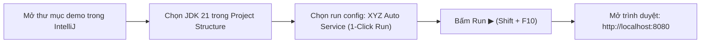

# 🚗 XYZ Auto Service — Workshop Operating System (WorkshopOS)

<div align="center">

[](https://openjdk.org/projects/jdk/21/)
[](https://spring.io/projects/spring-boot)
[](https://www.postgresql.org/)
[](docs/architecture.md)
[-success?style=for-the-badge&logo=junit5&logoColor=white)](docs/test-report.md)
[](https://maven.apache.org/)

**Ứng dụng quản lý xưởng dịch vụ ô tô trực tuyến, điều phối công suất khoang kỹ thuật và theo dõi tiến độ sửa chữa xe thời gian thực.**  
*Đồ án học phần môn học: **Quản lý Dự án Phần mềm (Mã lớp học phần: 71ITSE41503)***

</div>

---

## 📑 MỤC LỤC
1. [Tổng quan dự án & Bối cảnh nghiệp vụ](#1-tổng-quan-dự-án--bối-cảnh-nghiệp-vụ)
2. [Các chức năng cốt lõi (Phạm vi F01 – F09)](#2-các-chức-năng-cốt-lõi-phạm-vi-f01--f09)
3. [Điểm sáng kỹ thuật & Quyết định kiến trúc (ADRs)](#3-điểm-sáng-kỹ-thuật--quyết-định-kiến-trúc-adrs)
4. [Hướng dẫn khởi chạy 1-Click trên IntelliJ IDEA (Khuyên dùng)](#4-hướng-dẫn-khởi-chạy-1-click-trên-intellij-idea-khuyên-dùng)
5. [Hướng dẫn triển khai với PostgreSQL thật](#5-hướng-dẫn-triển-khai-với-postgresql-thật)
6. [Danh bạ tài khoản mẫu dùng thử hệ thống](#6-danh-bạ-tài-khoản-mẫu-dùng-thử-hệ-thống)
7. [Kịch bản 6 bước trình diễn luồng nghiệp vụ chuẩn](#7-kịch-bản-6-bước-trình-diễn-luồng-nghiệp-vụ-chuẩn)
8. [Minh chứng kiểm thử tích hợp tự động](#8-minh-chứng-kiểm-thử-tích-hợp-tự-động)
9. [Cấu trúc mã nguồn chuẩn hóa](#9-cấu-trúc-mã-nguồn-chuẩn-hóa)
10. [Hệ thống tài liệu dự án (@docs)](#10-hệ-thống-tài-liệu-dự-án-docs)

---

## 1. TỔNG QUAN DỰ ÁN & BỐI CẢNH NGHIỆP VỤ

### 1.1. Bối cảnh (Problem Statement)
Trung tâm dịch vụ ô tô XYZ trước đây vận hành tiếp nhận xe bằng điện thoại, bảng tính Excel và sổ tay phân tán:
* Khách hàng không nắm được thời điểm xưởng còn chỗ trống.
* Tình trạng dồn ứ nhiều xe vào cùng một khung giờ vượt quá năng lực phục vụ của cầu nâng và kỹ thuật viên (Overbooking).
* Khách hàng khó nắm bắt tiến độ xử lý của xe sau khi bàn giao vào xưởng.
* Ban giám đốc thiếu dữ liệu định lượng về công suất khai thác trạm và doanh thu ước tính.

### 1.2. Mục tiêu giải pháp (Solution Vision)
WorkshopOS được xây dựng nhằm khép kín toàn bộ chu trình dịch vụ từ lúc khách hàng tra cứu, đặt lịch trực tuyến, nhân viên tiếp nhận phân khoang, đến khi bàn giao xe hoàn tất với tiêu chí: **Trực quan - Chống nghẽn - Bảo mật - Chạy 1-click không phụ thuộc cấu hình phức tạp**.

---

## 2. CÁC CHỨC NĂNG CỐT LÕI (PHẠM VI F01 – F09)

| Mã | Chức năng | Phân hệ | Mô tả thực thi |
| :---: | :--- | :---: | :--- |
| **F01** | **Quản lý dịch vụ** | Manager | Quản lý danh mục 8 gói bảo dưỡng/sửa chữa chuẩn: thời lượng, bảng giá, checklist và bật/tắt kích hoạt. |
| **F02** | **Tra cứu dịch vụ** | Public/Client | Bộ lọc danh mục theo nhóm kỹ thuật (Bảo dưỡng, Phanh, Thay dầu, Động cơ...), tìm kiếm nhanh và xem chi tiết. |
| **F03** | **Đặt lịch trực tuyến** | Customer | Đặt lịch theo Biển số xe, Model, Ngày (Thứ 2 – Thứ 7), 8 khung giờ (08:00–16:00) và chọn gói dịch vụ. |
| **F04** | **Quản lý lịch hẹn** | Staff/Manager | Lễ tân xem danh sách toàn xưởng, duyệt lịch (`CONFIRMED`) gán Khoang 1–4 và KTV, hoặc từ chối (`REJECTED`). |
| **F05** | **Thay đổi & Hủy lịch** | Customer | Khách đổi ngày/giờ/dịch vụ (chuyển về `PENDING` để duyệt lại) hoặc hủy lịch an toàn khi chưa sửa xe. |
| **F06** | **Theo dõi trạng thái** | Customer | Khách theo dõi vòng đời: `PENDING` ➔ `CONFIRMED` ➔ `IN_PROGRESS` ➔ `COMPLETED`. |
| **F07** | **Quản lý năng lực xưởng** | System/Manager | Kiểm soát giới hạn 3 xe/slot (chỉnh được 1–5); Khóa bi quan chống tranh chấp; Chặn trùng biển số. |
| **F08** | **Báo cáo thống kê** | Manager | Dashboard quản trị đo lường: Tổng số lịch, tỷ lệ tiếp nhận/hủy, lượt đặt và doanh thu dự kiến theo từng dịch vụ. |
| **F09** | **Quản lý tài khoản** | All Roles | Đăng nhập/Đăng ký qua SĐT, băm mật khẩu BCrypt, Session Cookie bảo mật, phân quyền nghiêm ngặt 3 vai trò. |

---

## 3. ĐIỂM SÁNG KỸ THUẬT & QUYẾT ĐỊNH KIẾN TRÚC (ADRs)

1. **Khóa Bi Quan (Pessimistic Locking `SELECT ... FOR UPDATE`)**:
   * Tại [`WorkshopService.java`](src/main/java/com/example/demo/WorkshopService.java#L125), mọi giao dịch đặt chỗ đều khóa dòng cấu hình trạm `workshop_settings` (`id = 1`).
   * Triệt tiêu 100% rủi ro điều kiện tranh đua (Race Condition) khi nhiều khách cùng bấm nút đặt lịch trong cùng một mili-giây.
2. **Bảo Toàn Giá Lịch Sử (Price Snapshotting)**:
   * Giá và thời lượng dịch vụ được lưu bản chụp cứng (`@Embeddable ServiceSnapshot`) vào bảng `workshop_appointment_services`.
   * Việc Quản lý thay đổi giá dịch vụ sau này không bao giờ làm sai lệch số tiền của các lịch hẹn đã chốt trong quá khứ.
3. **Cơ Chế Đa Profile (Dual Profile Resilience)**:
   * **Profile `dev` (Default)**: CSDL In-Memory tương thích chuẩn ngữ pháp PostgreSQL (`MODE=PostgreSQL`). Bấm Run là chạy ngay trong 2 giây, không cần cài đặt CSDL ngoại vi.
   * **Profile `postgres`**: Kết nối trực tiếp vào PostgreSQL thật (Cổng `5433` cục bộ hoặc `5432` Docker).
4. **Kiến Trúc Đơn Khối Tích Hợp (Single-Source Monolith)**:
   * Frontend (HTML5, Tailwind CSS, Vanilla JS State Machine, FontAwesome) nằm trực tiếp tại `src/main/resources/static/`, do Spring Boot phân phối tại `http://localhost:8080/`.
   * Không gặp vấn đề CORS, đồng bộ Session Cookie và CSRF Token tự nhiên.

---

## 4. HƯỚNG DẪN KHỞI CHẠY 1-CLICK TRÊN INTELLIJ IDEA (KHUYÊN DÙNG)

Dự án đã được tích hợp sẵn **Shared Run Configurations** trong thư mục `.idea/runConfigurations/`.



### Các bước thực hiện:
1. Mở **IntelliJ IDEA** ➔ Chọn **Open** ➔ Duyệt đến thư mục `demo`.
2. Kiểm tra Project SDK: Vào **File ➔ Project Structure ➔ Project ➔ SDK** chọn **JDK 21** (ví dụ `ms-21`).
3. Trên thanh công cụ trên cùng, chọn cấu hình:
   👉 **`XYZ Auto Service (1-Click Run)`**
4. Bấm nút **Run ▶** (hoặc nhấn `Shift + F10`).
5. **Ứng dụng tự động khởi chạy hoàn tất sau 2–3 giây** tại: **`http://localhost:8080`**.

---

## 5. HƯỚNG DẪN TRIỂN KHAI VỚI POSTGRESQL THẬT

### Cách 1: Sử dụng Docker Compose (Chuẩn cổng 5432)
```bash
# Khởi động container PostgreSQL và tự nạp dữ liệu mẫu
docker compose up -d

# Chạy ứng dụng qua terminal
$env:DB_URL = "jdbc:postgresql://localhost:5432/xyz_auto_service"
$env:DB_USER = "postgres"
$env:DB_PASSWORD = "postgres"
.\mvnw.cmd spring-boot:run
```

### Cách 2: Sử dụng Dịch vụ PostgreSQL 18 Cục bộ (Cổng 5433 trên máy)
1. Tạo Database trong pgAdmin hoặc terminal:
   ```sql
   CREATE DATABASE xyz_auto_service WITH ENCODING 'UTF8';
   ```
2. Nạp script cơ sở dữ liệu:
   ```powershell
   & "C:\Program Files\PostgreSQL\18\bin\psql.exe" -U postgres -p 5433 -d xyz_auto_service -f xyz_auto_service_postgresql.sql
   ```
3. Trong IntelliJ IDEA, chọn cấu hình:
   👉 **`XYZ Auto Service (PostgreSQL)`** ➔ Bấm **Run ▶**.

---

## 6. DANH BẠ TÀI KHOẢN MẪU DÙNG THỬ HỆ THỐNG

Hệ thống luôn tự động nạp sẵn 3 tài khoản mẫu đại diện cho 3 vai trò nghiệp vụ (Mật khẩu mặc định: **`12345678`**):

| Vai trò người dùng | Số điện thoại đăng nhập | Mật khẩu | Phạm vi quyền hạn kiểm thử |
| :--- | :---: | :---: | :--- |
| **Quản lý Xưởng (`MANAGER`)** | **`0901234567`** | `12345678` | Quản lý danh mục dịch vụ, đổi sức chứa trạm (capacity), phân quyền nhân viên, xem thống kê & doanh thu dự kiến |
| **Lễ tân Tiếp nhận (`STAFF`)** | **`0912345678`** | `12345678` | Xem lịch toàn xưởng, duyệt tiếp nhận xe, phân khoang Bay 1–4, gán KTV, tạo lịch trực tiếp tại quầy |
| **Khách hàng Mẫu (`CUSTOMER`)** | **`0988888888`** | `12345678` | Khách VIP, đặt lịch trực tuyến, theo dõi tiến độ xe, thay đổi hoặc hủy lịch hẹn |

*(Khách hàng mới có thể tự đăng ký tài khoản trực tiếp ngay trên giao diện web).*

---

## 7. KỊCH BẢN 6 BƯỚC TRÌNH DIỄN LUỒNG NGHIỆP VỤ CHUẨN

```text
Khách xem dịch vụ ➔ Chọn thời gian ➔ Đặt lịch trực tuyến ➔ Kiểm tra năng lực trạm ➔ Lưu lịch hẹn ➔ Nhân viên duyệt & gán khoang
```

1. **Bước 1 (Xem dịch vụ)**: Truy cập `http://localhost:8080`, xem 8 gói dịch vụ bảo dưỡng tiêu chuẩn với thời lượng và đơn giá niêm yết rõ ràng.
2. **Bước 2 (Đăng nhập Khách hàng)**: Đăng nhập tài khoản `0988888888` / `12345678`.
3. **Bước 3 (Thao tác Đặt lịch)**: Chọn ngày hẹn trong tuần, chọn khung giờ còn trống (ví dụ: `09:00`), nhập Biển số xe (`51K-888.88`), Model xe (`Mazda CX-5`), chọn gói dịch vụ và bấm **Xác nhận đặt lịch**.
4. **Bước 4 (Hệ thống xác thực điều kiện)**: Hệ thống kiểm tra công suất trạm có khóa bi quan, chống trùng biển số, lưu bản ghi vào CSDL ở trạng thái `PENDING`.
5. **Bước 5 (Khách theo dõi tiến độ)**: Chuyển sang tab **"Tra cứu lịch hẹn"**, quan sát thấy lịch hẹn mới tạo hiển thị trực quan ở trạng thái chờ duyệt.
6. **Bước 6 (Nhân viên tiếp nhận & duyệt xe)**:
   * Đăng xuất, đăng nhập tài khoản Lễ tân: `0912345678` / `12345678`.
   * Vào tab **"Điều phối xưởng"**, bấm **"Tiếp nhận / Duyệt lịch"**.
   * Chọn **Khoang 1 - Cầu nâng 2 trụ** và chọn **KTV. Hoàng Tuấn** ➔ Bấm **Xác nhận**.
   * Lịch hẹn chuyển sang `CONFIRMED`. Nhân viên có thể lần lượt cập nhật xe sang `IN_PROGRESS` (Đang sửa) và `COMPLETED` (Hoàn thành bàn giao).

---

## 8. MINH CHỨNG KIỂM THỬ TÍCH HỢP TỰ ĐỘNG

Chạy toàn bộ bộ kiểm thử tự động bằng lệnh:
```powershell
$env:JAVA_HOME = "$env:USERPROFILE\.jdks\ms-21.0.11"
.\mvnw.cmd test
```

### Kết quả thực thi thực tế (100% Passed):
```text
[INFO] -------------------------------------------------------
[INFO]  T E S T S
[INFO] -------------------------------------------------------
[INFO] Running com.example.demo.DemoApplicationTests
[INFO] Tests run: 1, Failures: 0, Errors: 0, Skipped: 0, Time elapsed: 18.23 s
[INFO] Running com.example.demo.WorkshopFlowTests
[INFO] Tests run: 1, Failures: 0, Errors: 0, Skipped: 0, Time elapsed: 10.61 s
[INFO] 
[INFO] Results:
[INFO] Tests run: 2, Failures: 0, Errors: 0, Skipped: 0
[INFO] ------------------------------------------------------------------------
[INFO] BUILD SUCCESS
[INFO] ------------------------------------------------------------------------
```

---

## 9. CẤU TRÚC MÃ NGUỒN CHUẨN HÓA

```text
demo/
├── .idea/
│   └── runConfigurations/                 <-- Cấu hình chạy 1-Click chuẩn hóa của IntelliJ IDEA
│       ├── XYZ_Auto_Service__1_Click_Run_.xml
│       └── XYZ_Auto_Service__PostgreSQL_.xml
├── docs/                                  <-- Bộ tài liệu kỹ thuật hoàn chỉnh (@docs)
│   ├── phieu-pham-vi.md                   <-- Phiếu xác định phạm vi dự án (F01–F09)
│   ├── srs.md                             <-- Đặc tả yêu cầu phần mềm chi tiết
│   ├── architecture.md                    <-- Tài liệu kiến trúc Clean Layered Monolith
│   ├── api-contract.md                    <-- Đặc tả chi tiết các RESTful JSON endpoints
│   ├── deployment-guide.md                <-- Hướng dẫn vận hành & triển khai đa môi trường
│   ├── test-plan.md                       <-- Kế hoạch kiểm thử chất lượng
│   ├── test-report.md                     <-- Báo cáo kết quả kiểm thử tự động
│   ├── checklist-bao-mat.md               <-- Báo cáo an toàn thông tin & OWASP
│   ├── bug-log.md                         <-- Nhật ký khắc phục sự cố kỹ thuật
│   ├── thay-doi-thiet-ke.md               <-- Nhật ký quyết định kiến trúc (ADRs)
│   ├── usecase.drawio                     <-- Biểu đồ Use Case Diagram chuẩn XML
│   ├── erd.drawio                         <-- Biểu đồ thực thể CSDL 3NF chuẩn XML
│   └── architecture.drawio                <-- Biểu đồ kiến trúc hệ thống chuẩn XML
├── src/main/java/com/example/demo/
│   ├── DemoApplication.java              <-- Spring Boot Application Entry Point
│   ├── SecurityConfig.java               <-- Cấu hình Spring Security, Session & CSRF
│   ├── WorkshopController.java           <-- REST Controller & Exception Handler
│   ├── WorkshopService.java              <-- Nghiệp vụ lõi & Pessimistic Concurrency Lock
│   ├── WorkshopDomain.java               <-- JPA Entities chuẩn hóa 3NF
│   ├── InitialData.java                  <-- Tự động seed 8 dịch vụ & 3 tài khoản mặc định
│   ├── ApiModels.java                    <-- DTOs & Validation Contracts
│   ├── AccountRepository.java            <-- Data Access cho Tài khoản
│   ├── AppointmentRepository.java        <-- Data Access cho Lịch hẹn có Pessimistic Lock
│   ├── ServiceRepository.java            <-- Data Access cho Danh mục dịch vụ
│   └── SettingsRepository.java           <-- Data Access cho Cấu hình trạm có Pessimistic Lock
├── src/main/resources/
│   ├── application.properties             <-- Cấu hình chung & Profile mặc định (dev)
│   ├── application-dev.properties         <-- Cấu hình In-Memory PostgreSQL 1-Click Run
│   ├── application-postgres.properties    <-- Cấu hình kết nối PostgreSQL thật
│   └── static/                            <-- Frontend SPA (HTML5, Tailwind, app.js, Icons)
├── docker-compose.yml                     <-- Cấu hình Docker PostgreSQL độc lập
├── xyz_auto_service_postgresql.sql        <-- Kịch bản DDL & DML CSDL PostgreSQL
├── pom.xml                                <-- Quản lý dependencies Maven (Java 21, Spring Boot 4)
└── README.md                              <-- Hướng dẫn tổng thể đồ án
```

---

## 10. HỆ THỐNG TÀI LIỆU DỰ ÁN (@docs)

Tất cả các tài liệu kỹ thuật chuyên sâu được biên soạn đầy đủ và đặt tại thư mục [`docs/`](docs/):
* 📋 [Phiếu xác định phạm vi dự án](docs/phieu-pham-vi.md)
* 📖 [Đặc tả yêu cầu phần mềm (SRS)](docs/srs.md)
* 🏛️ [Tài liệu Kiến trúc hệ thống](docs/architecture.md)
* 🔌 [Hợp đồng giao diện API (API Contract)](docs/api-contract.md)
* 🚀 [Hướng dẫn Triển khai & Vận hành](docs/deployment-guide.md)
* 🧪 [Kế hoạch kiểm thử (Test Plan)](docs/test-plan.md)
* 📊 [Báo cáo kết quả kiểm thử (Test Report)](docs/test-report.md)
* 🛡️ [Checklist An toàn thông tin & Bảo mật](docs/checklist-bao-mat.md)
* 🐞 [Nhật ký lỗi & Biện pháp khắc phục (Bug Log)](docs/bug-log.md)
* 📝 [Nhật ký thay đổi thiết kế & ADRs](docs/thay-doi-thiet-ke.md)
* 🎨 [Sơ đồ Use Case (Draw.io)](docs/usecase.drawio)
* 🗄️ [Sơ đồ ERD 3NF (Draw.io)](docs/erd.drawio)
* 📐 [Sơ đồ Kiến trúc hệ thống (Draw.io)](docs/architecture.drawio)

---

<div align="center">
<strong>Phát triển với sự tận tâm bởi Nhóm sinh viên thực hiện Đồ án Quản lý Dự án Phần mềm</strong><br>
Khoa Công nghệ Thông tin — Khóa học 2026
</div>
